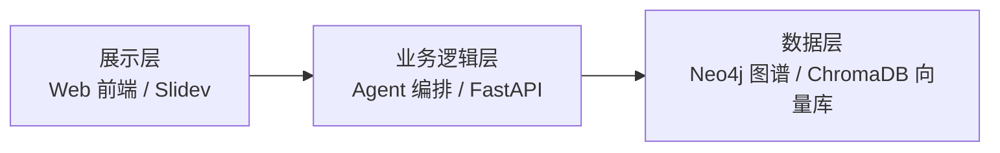

# 第一部分：用幻灯片展示产品介绍

## 哲学智能体——创新工程实践营项目答辩

**基于 RAG / 知识图谱 / 多智能体编排的领域问答系统**

日期：2026 年 11 月 28 日

---

# 目录

- **1. 产品设计**
- **2. 产品设计应用的原则**
- **3. 产品实现**

---

# 1. 产品设计

## 1.1 产品使命、口号和策略

- **1.1.1 使命**：让哲学知识“有据可查、有源可溯”，消除大模型在哲学领域的知识幻觉。
- **1.1.2 口号**：“探究思想脉络，追溯哲学本源。”
- **1.1.3 目标用户**：哲学专业学生、研究人员、深度哲学爱好者。
- **1.1.4 如何获得用户**：通过 GitHub 开源社区推广、高校哲学系试点合作、学术论坛分享。
- **1.1.5 团队优势**：具备扎实的 NLP 算法与 Agent 开发能力，熟悉知识图谱构建，且拥有丰富的哲学文本阅读积累。

---

# 1. 产品设计

## 1.1.6 如何做到差异化

| 维度 | 通用大模型 (如 ChatGPT) | 传统文献检索库 | 我们的“哲学智能体” |
|---|---|---|---|
| **回答方式** | 生成式，易产生事实幻觉 | 关键词匹配，缺乏逻辑推理 | 基于 RAG 与图谱生成，附带精准引用 |
| **多轮连贯性** | 上下文容易漂移、遗忘 | 无法进行多轮对话 | 三层记忆机制保障跨轮一致性 |
| **概念严谨度** | 容易混用不同流派同名概念 | 仅呈现原文字段 | 图谱锚点匹配，强约束概念边界 |

---

# 1. 产品设计

## 1.2 产品定义

### 产品描述的最简单模板：
- **对于**（哲学研究人员）
- **他们**（苦于大模型回答缺乏依据、无法追溯原文）
- **产品/项目** 是一个（基于知识图谱与多智能体编排的领域问答系统）
- **它能够**（提供带有精准原文引用的专业级哲学解答）
- **不同于**（通用大模型或传统检索库）
- **我们的产品/项目**（通过图谱与 RAG 双通道协作，确保逻辑推演与原文证据完美结合）。

---

# 1. 产品设计

## 1.2.1 解决的问题
解决大模型在哲学问答中的**“概念漂移”**（同名概念混用）与**“引用不可追溯”**（缺乏可验证的文本依据）两大痛点。

## 1.2.2 对客户的价值（用户故事）
> 作为一个**“比较哲学研究者”**，我想要**“快速对比康德与休谟在因果性上的原文表述”**，以便于**“我能在撰写论文时准确引用，避免概念混淆”**。
*(注：使用业务语言描述，不涉及底层技术)*

## 1.2.3 解决方案
提供 **Web 网页端应用** 及 **API 接口**，支持多轮长程对话。

---

# 2. 产品设计应用的原则

本项目参考【实战技能】产品设计小文集锦，应用了以下原则：

- **需求原则**：直击学术研究的“文献溯源”核心需求。
- **信息和创新原则**：打破纯文本 RAG 的局限，创新性引入知识图谱多跳推理。
- **系统和收敛原则**：构建“编排—记忆—护栏”三层闭环系统，确保输出收敛且可控。
- **定量和简化原则**：通过护栏过滤低置信度片段，简化生成过程中的不确定性。
- **继承和时间原则**：基于成熟的开源生态快速构建，缩短研发周期。

---

# 3. 产品实现

## 3.1 用户体验设计考虑的因素
- **交互简洁**：对话式 UI，支持 Markdown 渲染与原文片段高亮。
- **可解释性**：回答下方直接展示引用的文献来源与章节（Chunk ID）。
- **响应速度**：引入语义缓存与图谱索引，降低大模型首字延迟。

## 3.2 产品所用编程语言及IDE、平台、框架等

| 条目名称 | 条目内容 | 版本号 | 选型原因/备注 |
|---|---|---|---|
| **编程语言** | Python | 3.10.12 | AI 与 NLP 生态最完善 |
| **IDE** | VS Code | 1.85.0 | 轻量且支持远程开发 |
| **大模型框架** | LangChain | 0.1.0 | 成熟的 Agent 编排生态 |
| **图数据库** | Neo4j | 5.15.0 | 擅长处理复杂的图遍历查询 |
| **向量数据库** | ChromaDB | 0.4.22 | 轻量级本地向量检索库 |
| **接口框架** | FastAPI | 0.109.0 | 自动生成 Swagger 文档，性能高 |

*(注：技术选型遵循“不要太重，也不要太轻”的原则，均写入项目 readme.md)*

---

# 3. 产品实现

## 3.3 代码仓库链接及代码提交历史

- **仓库链接**：[点击访问 GitHub 仓库](https://github.com/cuiningran-spec/philosophy-agent)

  

    
    
Git 提交历史

  

  

    
    
Team Planning 看板

  

---

# 3. 产品实现

## 3.4 整个生命周期遇到的问题及解决方法

| 问题类别 | 问题名称 | 发生原因 | 解决办法 |
|---|---|---|---|
| 分析阶段 | 概念同名冲突 | 不同哲学家对同一词汇定义不同 | 引入知识图谱锚点匹配，强制对齐概念 ID |
| 测试阶段 | 引用幻觉未消除 | 大模型强行编造不存在的文献 | 输出侧护栏介入，强制校验引用合法性 |
| 部署阶段 | 幻灯片构建失败 | 本地环境与 Playwright 兼容性问题 | 改用 GitHub Actions 云端自动构建部署 |
---

# 3. 产品实现

## 3.5 软件概要设计
### 3.5.0 使用工具
使用 **Mermaid** 进行图表绘制，支持纯文本代码化图表。

### 3.5.1 系统架构图（Web应用三层架构）

### 3.5.2 基础设施图
本项目部署于单台云服务器（GitHub Actions 自动推送），故省略架构图。

---

# 3. 产品实现

## 3.5.3 算法模型设计说明（智能体技术设计）

本项目使用 LangChain 编排哲学智能体，其核心技术设计如下：

1. **任务编排**：采用**规划—执行分离**结构，将复杂哲学问题拆解为子任务 DAG（有向无环图）。
2. **工具调用**：每个工具声明输入契约（参数 schema）、输出契约（置信度）、副作用声明。
3. **记忆机制**：工作记忆（当前对话）、语义记忆（概念摘要）、情景记忆（问答轨迹）协同工作。
4. **护栏（Guardrails）**：输入侧拦截越界问题，检索侧过滤低置信度文本，输出侧校验引用真实性。
5. **专业知识库协作**：
   - **RAG** 负责**召回广度**（原文本片段）；
   - **图谱** 负责**关系精度**（多跳逻辑推理）；
   - 两者通过 Chunk ID 双向关联，结合记忆层，确保最终回答可信。

---

# 3. 产品实现

## 3.5.4 数据库设计
- **图数据库（Neo4j）**：节点包括“哲学家、著作、概念、命题”，关系包含“提出、继承、批判、引用”等。
- **向量数据库（ChromaDB）**：存储原文章节的 Embedding，实现语义检索。
- *(注：关系型数据库仅使用 SQLite 存储用户基本会话记录，核心为图与向量双库)*

## 3.5.5 接口设计
| 接口名称 | 接口功能 | 输入变量或对象 | 输出对象 |
|---|---|---|---|
| `/chat/completions` | 核心问答接口 | `query` (问题), `session_id` | 回答文本, 引用列表 |
| `/graph/search` | 图谱实体查询 | `entity_name` (概念名) | 实体关系 JSON 图 |

*(注：接口已使用 FastAPI 和 Swagger 自动生成文档)*

---

# 3. 产品实现

## 3.6 软件质量

### 3.6.1 质量控制和保证方法
- **代码日志**：全链路接入 `logging`，记录 Agent 的思考过程与耗时。
- **异常和错误处理**：对外部 API 调用、数据库查询加入了 `try-except` 和重试机制，防止系统崩溃。

### 3.6.2 质量工具使用
- **PEP8 规范**：使用 `autopep8` 插件格式化。
- **Pylint 语义分析**：[此处插入 Pylint 扫描结果截图，展示无 Blocker]。
- **代码复杂度**：[此处插入 VSCode `CodeMetrics` 或 `complexipy` 插件截图]。

---

# 3. 产品实现

## 3.7 代码统计

- **代码行数与模块数**：[此处插入 VS Code Counter 插件统计截图]
  - Python 后端模块：X 个
  - 代码总行数：约 X,XXX 行
- **AI Vibe coding / 团队自己编写比例**：
  - 基础代码骨架使用 AI 辅助生成（约 30%）
  - 核心业务逻辑（图谱构建、护栏规则、Prompt 调优）均由团队手写完成（约 70%）。

---

# 附录：相关开源代码与文献来源

按照答辩要求，本项目在研发及本汇报过程中参考了以下开源项目和文献：

1. **Slidev 幻灯片框架**: https://github.com/slidevjs/slidev
2. **Mermaid 图表渲染引擎**: https://mermaid.js.org/
3. **LangChain 智能体框架**: https://github.com/langchain-ai/langchain
4. **AnchorRAG 检索框架**: 参考自相关多智能体检索学术论文。
5. **GraphRAG 协作模式**: 参考自微软 GraphRAG 相关文献及开源实现。
6. **提示词模板**: https://github.com/bettermorn/AIAgent/blob/main/courseware/AIAgentPromptTemplate.md
7. **部署工作流参考**: https://github.com/bettermorn/AIAgent/tree/main/code/IndustryAgent/WindOnMAgent/deployment.md

---

# 第二部分：展示作品功能 

**在本机运行作品，展示核心功能逻辑：**

1. **展示单概念界定**：提问哲学概念，展示返回原文片段及引用来源。
2. **展示跨哲学家比较**：提问“比较康德与休谟的因果性”，展示 DAG 拆解与对比生成。
3. **展示多轮追问**：追问“刚才引用的原文出自哪一章”，验证情景记忆。
4. **展示边界测试**：提出超纲问题，展示护栏拒绝或降级处理。

*(演示完毕)*

---

# 第三部分：回答评委问题 

## 感谢聆听，欢迎提问！
