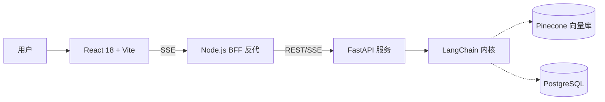
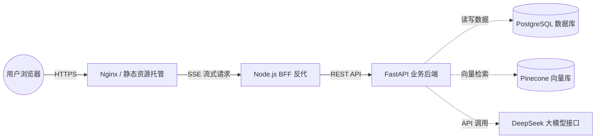

# 哲学智能体

## 知识库检索智能体

**帮助用户从多个哲学视角理解现实问题，形成个人思考的 AI Agent**

日期：2026 年 11 月

---

# 目录

- **1. 产品设计**
- **2. 产品设计应用的原则**
- **3. 产品实现**

---

# 1. 产品设计

## 1.1 产品使命、口号和策略

- **1.1.1 使命**：打破单一思维的局限，帮助用户从多个哲学视角审视现实问题，最终形成属于个人的独立见解。
- **1.1.2 口号**：“多一种视角，多一种可能。”
- **1.1.3 目标用户**：面临人生困惑的青年群体、对哲学思辨感兴趣的爱好者、需要思维启发的创作者。
- **1.1.4 如何获得用户**：通过高质量哲学社群推广、社交媒体“现实问题+哲学视角”内容引流。
- **1.1.5 团队优势**：具备全栈开发能力（React + Node.js + FastAPI），深入理解 LangChain 编排机制，且拥有丰富的人文知识积累。

---

# 1. 产品设计

## 1.1.6 如何做到差异化

| 维度 | 通用大模型 (如 ChatGPT) | 传统问答社区 | 我们的“ThinkLab 智能体” |
|---|---|---|---|
| **回答方式** | 单一生成 | 人类主观碎片化回答 | **生成 3 种截然不同的哲学视角供选择** |
| **深度体验** | 缺乏追问空间 | 难以进行深度多轮对话 | 选择视角后，基于 RAG 知识库进行**深度多轮追问** |
| **最终产出** | 没有沉淀 | 页面冗长难以阅读 | **一键生成结构化思考总结（洞见/张力/实践）** |

---

# 1. 产品设计

## 1.2 产品定义与用户故事

### 产品定义：
- **对于**（面临现实困惑的用户）
- **他们**（苦于大模型回答过于同质化，缺乏多元视角）
- **产品/项目** 是一个（多视角哲学探索智能体）
- **它能够**（针对用户的现实问题，生成三种不同的哲学视角，并引导用户持续追问，最终生成思考总结）
- **不同于**（传统的聊天机器人）
- **我们的产品**（强调“探索”与“沉淀”，通过 RAG 知识库确保回答的哲学严谨性）。

## 用户故事
> 作为一个“**面临职业焦虑的青年**”，我想要“**看看斯多葛主义和存在主义会怎么看待我现在的处境**”，以便于“**我能跳出单一的情绪，形成自己的解决思路**”。

---

# 2. 产品设计应用的原则

本项目在设计中应用了以下原则：

- **需求原则**：直击用户“需要多视角启发”的核心需求。
- **信息和创新原则**：创新性地引入“三视角生成”与“结构化总结”流程。
- **系统和收敛原则**：限制模型只扮演特定流派，禁止跨流派漂移，确保视角纯粹。
- **降级和可用原则**：实行“零密钥体验”策略，在无模型 Key 时自动降级模板引擎，保证永不宕机。

---

# 3. 产品实现

## 3.1 用户体验设计因素
- **交互简洁**：对话式 UI，纸质/墨色的视觉风格，契合哲学思辨的沉静感。
- **可解释性**：界面直接展示检索出处（“这一步借用了知识库中的...”），提升可信度。
- **流式响应**：后端支持 SSE，前端边打边出，极大降低用户等待焦虑。

---

## 3.2 编程语言及框架选型

| 条目名称 | 条目内容 | 选型原因 |
|---|---|---|
| **Agent 编排** | LangChain | 统一 Prompt / LLM / Parser 链式调用。 |
| **LLM 模型** | DeepSeek-chat | 兼容 OpenAI 协议，成本低，中文能力强。 |
| **向量数据库** | Pinecone | Serverless 索引自动创建，检索性能优异。 |
| **API 框架** | FastAPI | 异步支持极好，自动生成 Swagger 文档。 |
| **持久化** | PostgreSQL | 支持 JSONB，完美适配结构化总结的存储。 |
| **前端/服务** | React + Node.js | Vite 极速打包，Node 作为 BFF 层反向代理支持 SSE 透传。 |

---

# 3. 产品实现

## 3.3 代码仓库与生命周期管理
- **仓库链接**：[点击访问 GitHub 仓库](https://github.com/cuiningran-spec/philosophy-agent）

  

    
    
Git 提交历史

  

  

    
    
Team Planning 看板

  

---

## 3.4 生命周期遇到的问题及解决

| 问题类别 | 问题名称 | 解决办法 |
|---|---|---|
| 分析阶段 | 多流派概念混淆 | 在系统提示词中锁定当前视角，禁止模型跨流派闲聊。 |
| 开发阶段 | 长对话导致 Token 爆炸 | 引入多轮记忆机制，超过 8 轮自动压缩为“滚动摘要”。 |
| 部署阶段 | 缺乏模型 Key 时无法演示 | 设计自动降级策略，无缝切换至本地模板模型。 |

---

# 3. 产品实现

## 3.5.1 软件概要设计：系统架构图

---

## 3.5.2 基础设施与部署架构图

---

## 3.5.3 智能体技术设计

1. **多视角生成**：用户提问后，RAG 检索知识库，通过 `PydanticOutputParser` 强制模型输出 3 种截然不同的哲学视角。
2. **加权 RAG 检索**：召回3条语料后，按当前流派加权（同流派 +0.18），确保回答不串味。
3. **多轮记忆机制**：
   - **窗口记忆**：保留最近 6 轮对话。
   - **滚动摘要**：超过 8 轮，触发 LLM 压缩生成摘要存入数据库，实现长对话不丢上下文且不膨胀。
4. **抗崩设计（护栏）**：LLM 如果调用失败（网络或鉴权问题），自动降级至模板模型继续输出，不中断对话。

---

## 3.5.4 数据库设计
数据库中的核心表来管理全部链路数据：
- `sessions`（会话）：记录问题、选择的视角以及**滚动摘要**。
- `perspectives`（视角）：记录生成的三种哲学视角详情。
- `messages`（对话）：流水记录，包含 JSONB 格式的引用来源。
- `summaries`（总结）：支持版本记录（Version 递增），即使生成了总结，依然可以继续对话。
- `knowledge_docs`（知识库文档）：34 条种子语料与 12 条 FAQ。

---

## 3.5.5 接口设计
对外暴露三个核心接口：
| 接口名称 | 功能 | 特点 |
|---|---|---|
| `POST /api/sessions` | 创建会话生成视角 | 并发调用大模型与向量库 |
| `POST /api/sessions/{id}/messages/stream` | 流式对话 | **SSE（Server-Sent Events）** 实时推送 |
| `POST /api/sessions/{id}/summaries` | 生成思考总结 | 输出洞见、张力、实践等结构化 JSON |

---

## 3.6.1 质量控制：全链路日志与降级

  

    
    
全链路日志配置，支持文件写入

  

  

    
    
异常兜底：DeepSeek 失败降级模板模型

  

> **零密钥体验**：即使没有任何 API Key 和数据库，通过 SQLite 降级和本地哈希向量降级，系统仍能完整跑通 MVP。

---

## 3.6.2 质量工具：Pylint 扫描与复杂度

  

    
    
Pylint 规范扫描：0 阻断性错误

  

  

    
    
所有函数圈复杂度低，通过检测

  

---

## 3.7 代码统计：全栈模块划分

- **模块划分**：`core_engine`（AI 内核）、`backend`（FastAPI 后端）、`frontend`（React 前端）。
- **AI 辅助生成 (80%)**：UI 组件、样板 CRUD 代码。
- **团队手写 (20%)**：RAG 重排逻辑、多轮记忆压缩、异常降级兜底机制。

---

# 附录：相关开源代码与文献来源

1. **Slidev 幻灯片框架**: https://github.com/slidevjs/slidev
2. **LangChain 智能体框架**: https://github.com/langchain-ai/langchain
3. **Pinecone 向量数据库**: https://www.pinecone.io/
4. **DeepSeek API 文档**: https://platform.deepseek.com/
5. **FastAPI 官方文档**: https://fastapi.tiangolo.com/

---

# 第二部分：展示作品功能 

**在本机运行作品，展示核心功能逻辑：**

1. **多视角生成**：输入现实问题（如“我最近很焦虑”），展示生成的三种哲学视角（斯多葛、存在主义、尼采）。
2. **知识库溯源**：选择其中一个视角，提问并展示回答底部引用的「知识库出处」。
3. **多轮记忆验证**：追问几个问题后，问“我最开始问你的问题是什么”，验证记忆窗口。
4. **结构化总结**：点击生成总结，展示包含“洞见、张力、实践”的结构化卡片。

*(演示完毕)*

---

# 第三部分：回答评委问题 

## 感谢聆听，欢迎提问！
