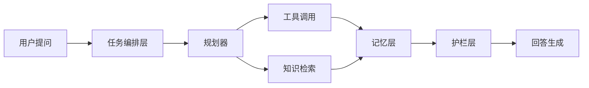
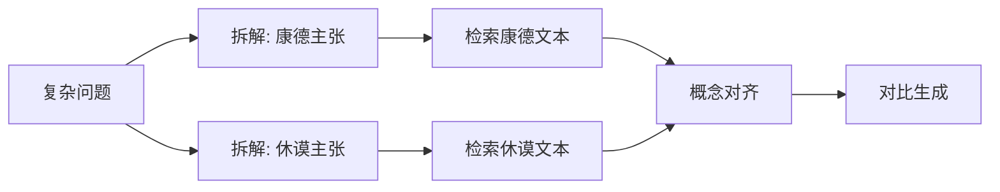
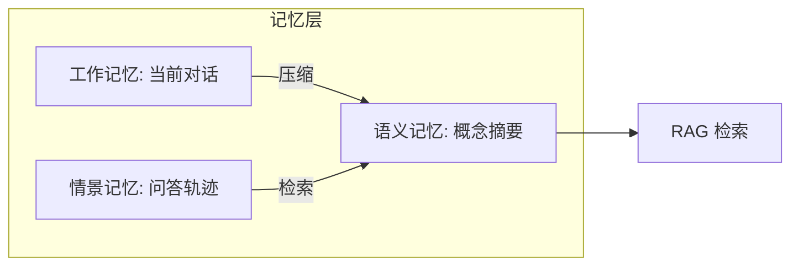
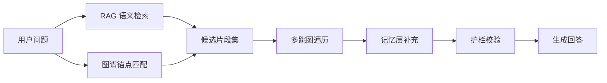

# 哲学智能体

## 创新工程实践营项目答辩

**基于 RAG / 知识图谱 / 多智能体编排的领域问答系统**

日期：2026 年 11 月

---

# 目录

- 项目背景与目标
- 系统总体架构
- 技术设计：任务编排与工具调用
- 技术设计：记忆与护栏
- 技术设计：专业知识库与 RAG / 知识图谱协作
- 功能演示
- 总结与展望

---

# 1. 项目背景与目标

哲学文本具有 **概念密集、跨文本引用多、语境依赖强** 的特点，通用大模型直接回答容易产生两种问题：

- **概念漂移**：不同哲学传统中的同名概念被混用；
- **引用不可追溯**：回答缺乏可验证的文本依据。

本项目构建 **哲学领域智能体**，目标：

- 将哲学家、学派、著作、概念组织为 **可检索、可推理的结构化知识**；
- 使回答 **有据可查、有源可溯**，降低幻觉；
- 用 **多智能体编排** 将复杂哲学问题拆解为可执行的子任务链。

---

# 2. 系统总体架构

**分层逻辑**：

- **编排层** 决定“做什么”：直接回答、澄清意图，还是拆解为工具链；
- **检索层** 决定“依据什么”：同时接入 RAG 与知识图谱；
- **记忆层** 决定“记住什么”：区分工作记忆、语义记忆与情景记忆；
- **护栏层** 决定“不能做什么”：在输出前做一致性、安全性与引用校验。

---

# 3. 技术设计：任务编排

## 3.1 双层编排：规划与执行解耦

哲学问题常包含多个子命题，单轮工具调用容易 **误差累积**。本项目采用 **规划—执行分离** 的结构：

- **规划层**：LLM 判断任务类型，输出 **子任务 DAG**（有向无环图）；
- **执行层**：按 DAG 依赖顺序调用工具，支持并行分支与失败重试。

这一设计参考了 **图驱动双层规划** 的思路：规划层不关心工具内部复杂度，执行层通过工具关系图选择稳健的调用序列。

---

# 3. 技术设计：任务编排

## 3.2 工具调用的三类契约

每个工具在注册时声明：

| 契约 | 内容 |
|---|---|
| 输入契约 | 参数 schema、必填项、取值范围 |
| 输出契约 | 返回结构、置信度字段、来源标注 |
| 副作用声明 | 是否读写记忆、是否访问外部服务 |

编排器只依赖契约，不依赖工具实现，因此新增哲学数据源不需要修改编排逻辑。

---

# 4. 技术设计：记忆机制

哲学问答是多轮、长程任务，需要区分 **短期上下文** 与 **长期领域知识**。记忆层分为三级：

- **工作记忆**：保留当前对话的原始消息，用于消解指代与追问；
- **语义记忆**：将知识图谱中的概念—关系对压缩为摘要，避免重复遍历；
- **情景记忆**：记录“哪个问题用了哪些片段”，提供可追溯路径。

---

# 5. 技术设计：护栏

哲学领域对 **概念误用** 和 **来源伪造** 尤其敏感。护栏在三个位置生效：

| 位置 | 护栏类型 | 作用 |
|---|---|---|
| 输入侧 | 意图边界 | 拒绝非哲学问题，或提示切换场景 |
| 检索侧 | 可信度过滤 | 低置信度片段不进入生成上下文 |
| 输出侧 | 引用一致性校验 | 回答中的引用必须映射回检索结果 |

输出侧护栏与记忆层联动：如果模型生成的内容引用了 **不存在的来源**，护栏触发重写或降级为“无法确认”。使系统保持 **可审计的保守性**。

---

# 6. 技术设计：专业知识库与 RAG / 知识图谱协作

## 6.1 知识组织：图谱 + 文本双通道

本项目采用双通道架构，兼顾 **语义检索的广度** 与 **图推理的精度**：

- **知识图谱**：承载哲学家 — 著作 — 概念 — 命题的显式关系；
- **文本片段库**：承载原文语境，适合 RAG 语义检索；
- **双向关联**：图谱节点与文本片段通过 `chunk_id` 互相指向。

 

---

# 6. 技术设计：专业知识库与 RAG / 知识图谱协作

## 6.2 RAG 与知识图谱的分工

| 问题类型 | 主要通道 | 辅助通道 |
|---|---|---|
| “概念如何被界定” | RAG 文本检索 | 图谱定位节点 |
| “哲学家有何传承” | 知识图谱多跳 | RAG 补充证据 |
| “命题是否成立” | 双通道并行 | 护栏校验引用 |

 

**协作关键**：

- **RAG** 负责 **召回广度**；
- **图谱** 负责 **关系精度**；
- **记忆层** 负责 **跨轮一致性**；
- **护栏** 负责 **最终可信度**。

---

# 7. 功能演示

演示内容围绕评分表中 **“能顺利演示规划完成的作品功能”** 展开，按以下脚本推进：

1. **单概念界定**：提问一个哲学概念，展示 RAG 返回原文片段 + 引用来源；
2. **跨哲学家比较**：展示任务编排拆解为两个检索子任务，再对齐生成对比；
3. **多轮追问**：在同一会话中追问“你刚才引用的那段原文出自哪一章”；
4. **边界问题**：提出一个超出领域的问题，展示护栏拒绝或降级行为。

---

# 8. 部署：GitHub Actions + Slidev

## 8.1 自动化构建与发布

本项目采用 **Slidev + GitHub Actions** 实现幻灯片自动化部署。

- 幻灯片 Markdown 及配置文件统一放置于 `docs/slides` 目录下；
- 部署文档记录在 `docs/software/deployment.md`；
- 通过 GitHub Actions 自动触发构建并发布至 GitHub Pages。

## 8.2 部署核心流程

1. **代码推送**：修改 `docs/slides/slides.md` 并推送至 `main` 分支；
2. **自动构建**：GitHub Actions 监听变更并执行 `slidev build`；
3. **静态发布**：构建产物 `dist` 自动发布至 GitHub Pages。

---

# 9. 总结与展望

## 核心成果

- 构建了 **编排—记忆—护栏** 三层协同的哲学领域智能体架构；
- 打通了 **RAG 文本检索** 与 **知识图谱多跳推理** 的双通道协作；
- 实现了基于 GitHub Actions 的 **幻灯片自动化部署**。

## 未来展望

- **知识图谱扩充**：接入更多哲学传统，提升跨文化概念对齐能力；
- **多模态检索**：支持哲学手稿等非结构化资料的解析；
- **评测体系完善**：引入专家标注的引用准确率指标。

---
# 感谢聆听

## 欢迎提问